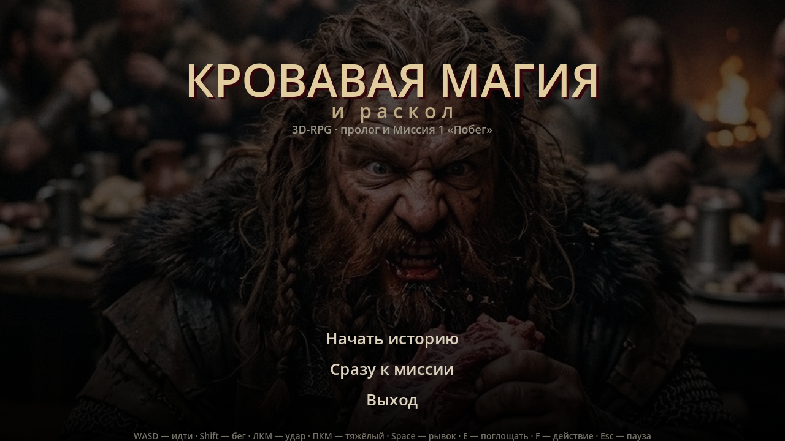
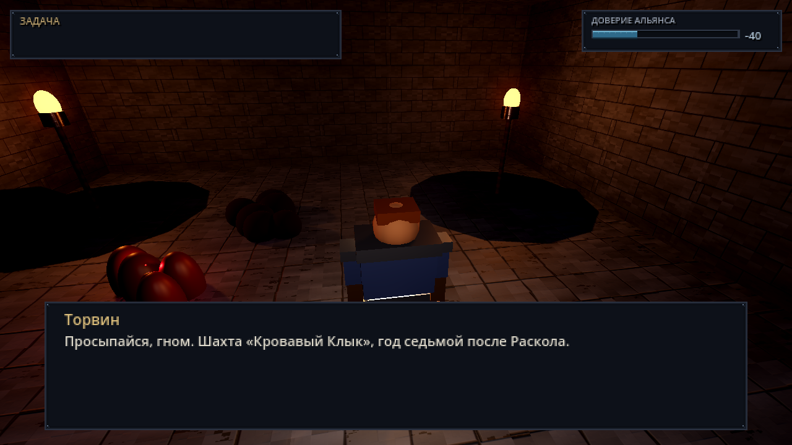

# Кровавая магия и Раскол — 3D-RPG

Тёмное фэнтези про гнома, который съел плоть погибшего друга, получил магию и
запустил мировую войну. Версия 2: **RPG от третьего лица** на Godot 4 (Forward+).




> Актуальный план развития: [`docs/07_NEXT_ROADMAP.md`](docs/07_NEXT_ROADMAP.md).
> Текущие визуальные дефекты: [`docs/08_VISUAL_BUGS.md`](docs/08_VISUAL_BUGS.md).

## Как запустить

`build\Raskol.exe` — автономный Windows-билд. Или `Play.cmd` в корне проекта.

Проект открывается в Godot 4.4.1 (`project.godot`, рендерер Forward+); движок
лежит в `tools\godot\`.

## Управление

| Клавиша | Действие |
|---|---|
| WASD | движение относительно камеры |
| мышь | вращение камеры от третьего лица |
| Ctrl | красться: тише, ниже, хуже видно |
| Shift | бег: быстрее, но громко и заметно |
| ЛКМ | быстрый удар |
| ПКМ | тяжёлый удар (замах) |
| Space | рывок (15 магии, 0.3 с неуязвимости) |
| Q | кровавый шип (10 магии, 18 урона, бьёт по направлению камеры) |
| G | бросить камень — шум-приманка для стражи |
| E | поглотить гнилую плоть (+25 магии, +3 Жажды) |
| F | взаимодействие: сломать решётку, рычаг, разговор, выход |
| 1/2/3 | варианты в диалогах |
| Esc | пауза / освободить мышь |
| F11 | полный экран вкл/выкл (сохраняется в `user://settings.cfg`) |

## Что реализовано

- **3D-подземелье** собирается кодом из карты `assets/level/m1.txt`: пол,
  стены, потолок, реквизит (факелы, бочки, вагонетки, решётки, наковальни),
  коллизии, туман, объёмный свет.
- **PBR-материалы**: процедурные бесшовные текстуры камня, кирпича, металла и
  дерева с нормалями и картами шероховатости (`src/build_3d_textures.py`).
- **Герой от третьего лица**: риг из примитивов, кодовая анимация (шаг, бег,
  удары, рывок, смерть), молот, камера с пружиной и коллизией.
- **Бой**: лёгкий/тяжёлый удар по дуге, отбрасывание, урон от Жажды, смерть.
- **Скрытность**: конус зрения 60°, дальность зрения зависит от света
  (тень ~7.5 м, факел ~17 м), присед и бег меняют заметность и шум, стража
  слышит шаги/поглощение/цепь/камень и переходит в «подозревает» → «поиск» →
  погоню, затем возвращается на пост.
- **Стража**: патруль, слух и зрение, подозрение/поиск, погоня, атаки,
  полоски здоровья над головой.
- **Босс** Гхарн: усиленный риг, 280 HP, отдельная полоса.
- **Сюжетный каркас**: диалоги, выбор с Селеной (влияет на Доверие и концовку),
  задачи, финальная сцена, экран завершения.
- **Меню** на фоне AI-постера и кинематик-пролог из видео (Google Flow).
- **Настройки видео**: экран в меню и в паузе — разрешение окна
  (1280×720 … 2560×1440) и полный экран, сохраняются в `user://settings.cfg`;
  F11 — быстрый тумблер полного экрана.
- **Автотест** прохождения: `Raskol.exe --headless -- --test3d`.

## Структура

```
scripts/
  main3d.gd      экраны: меню → кинематик → миссия → финал
  menu3d.gd      главное меню
  settings.gd    настройки видео (автолоад): разрешение, полный экран
  settings_screen.gd  экран «Настройки» (меню и пауза)
  dungeon.gd     сборка 3D-подземелья, свет, реквизит
  hero3d.gd      риг героя, движение, бой
  enemy3d.gd     стража и босс
  model_util.gd  загрузка glTF, подгонка по росту, клипы, крепление к кости
  cam3d.gd       камера от третьего лица
  mission3d.gd   сценарий миссии, задачи, диалоги
  hud.gd         интерфейс (масштабируется на 1280×720)
assets/tex3d/    PBR-текстуры
assets/art/      меню, постеры, панели пролога
assets/level/    карта m1.txt и список объектов m1_props.json
src/             генераторы: текстуры, арт, звук, кинематик
docs/            сценарий, ГДД, арт-библия, заметки о переходе на 3D
```

## Пересборка

```powershell
$py = "$env:USERPROFILE\.dsh\dsh-runtimes\dsh-primary-runtime\dependencies\python\python.exe"
& $py src\build_3d_textures.py     # PBR-текстуры
& $py src\build_menu_bg.py         # фон меню
& $py src\build_cinematic.py       # видео-пролог
& $py src\audio\build_audio.py     # музыка/эмбиент + процедурные SFX
& $py src\audio\build_audio_samples.py  # SFX v2 из CC0 (tools\cc0, только локально)
$env:APPDATA = "$PWD\tools\appdata"
tools\godot\Godot_v4.4.1-stable_win64_console.exe --headless --path . --import
tools\godot\Godot_v4.4.1-stable_win64_console.exe --headless --path . --export-release "Windows Desktop" build\Raskol.exe
```

Проверки перед коммитом (одна точка входа — `build.ps1`):

```powershell
powershell -ExecutionPolicy Bypass -File build.ps1 -Models   # .glb: скины, клипы, кости оружия
powershell -ExecutionPolicy Bypass -File build.ps1 -Test     # автотест (включает -Models)
powershell -ExecutionPolicy Bypass -File build.ps1 -Shots    # скриншоты tools\shot_3d_*.png
```

Озвучка пересобирается отдельно (нужен GPU, в CI не запускается):
`tools\tts_env\Scripts\python.exe src\voice\build_voice.py` — см. ROADMAP §5.5.

## Статус и что дальше

Играбельный вертикальный срез нового направления: меню → подземелье → бой →
босс → финал проходится целиком (проверено автотестом и в собранном билде).
Озвучка миссии 1 синтезирована (38 реплик, 101,7 с, 0,77 МБ ogg), автолоад
`Voice` подхватывает их по тексту из `voice_manifest.json`, но **на слух она
не принята** (сбитые ударения, ровная интонация) и помечена TODO: файлы лежат
как плейсхолдеры, субтитры — основной канал, перезапуск — в ROADMAP, Фаза 7.

Слабое место сейчас — переходы между анимациями: клипы переключаются
мгновенно, из-за чего на разгоне и после удара заметна «резинка». Это
следующий шаг (карточка T10 в `TASKS_AI.md`, AnimationTree + Blend2).
Дальше по важности:
1. плавные переходы idle/walk/run/attack (AnimationTree),
2. глубина боя: блок, комбо, хит-реакции,
3. больше реквизита и вертикального разнообразия в уровне,
4. прокачка/инвентарь (RPG-слой, ROADMAP Фаза 4),
5. озвучка v2 (ROADMAP Фаза 7) — когда игру можно пройти и послушать целиком.
